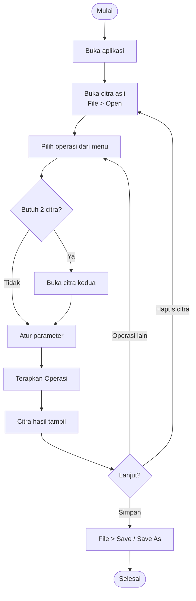

# Aplikasi Pengolahan Citra Digital (PCD)

Aplikasi desktop berbasis **Python + Tkinter** untuk melakukan berbagai operasi pengolahan citra digital: operasi dasar, perbaikan kualitas (enhancement), penambahan noise, hingga deteksi tepi. Citra asli dan citra hasil ditampilkan berdampingan sehingga perubahan dapat dibandingkan secara langsung.

Proyek ini dibuat untuk mata kuliah **Pengolahan Citra Digital** (Semester 5).

## Fitur

| Menu | Operasi |
| :--- | :--- |
| **File** | Open, Save, Save As, Exit |
| **Edit** | Undo, Redo (riwayat hingga 20 langkah) |
| **Basic Ops** | Negative, Arithmetic (Add, Subtract, Multiply, Divide), Boolean (NOT, AND, OR, XOR), Geometrics (Translation, Rotation, Zooming, Flipping, Cropping), Thresholding, Convolution, Fourier Transform, Colouring (Binary, Grayscale, RGB, HSV, CMY, YUV, YIQ, Pseudo) |
| **Enhancement** | Brightness, Contrast, Histogram Equalization, Smoothing (Lowpass, Median, ILPF, BLPF), Sharpening (Highpass, Highboost, IHPF, BHPF), Geometrics Correction |
| **Noise** | Gaussian, Rayleigh, Erlang (Gamma), Exponential, Uniform, Impulse |
| **Edge Detection Segmentation** | Sobel, Prewitt, Robert, Laplacian, Laplacian of Gaussian (LoG), Canny, Compass |
| **About** | Info tim pengembang, tautan GitHub dan YouTube |

Fitur pendukung:

- Tampilan dua panel: **Citra Asli** dan **Citra Hasil**.
- Slider/input parameter untuk operasi yang membutuhkannya.
- Operasi dua citra (misalnya Add, AND, OR, XOR) dengan citra kedua yang dapat dibuka terpisah.
- Jendela **histogram** untuk operasi tertentu.
- Pintasan keyboard.

### Pintasan Keyboard

| Pintasan | Fungsi |
| :--- | :--- |
| `Ctrl+O` | Buka citra |
| `Ctrl+S` | Simpan |
| `Ctrl+Shift+S` | Simpan sebagai |
| `Ctrl+Z` / `Ctrl+Y` | Undo / Redo |
| `Ctrl+Q` | Keluar |

## Antarmuka

Tata letak aplikasi:

- **Menu Bar (atas):** navigasi utama.
- **Area Citra (tengah):** citra asli dan citra hasil berdampingan.
- **Panel Kontrol (bawah):** slider parameter, tombol *Terapkan Operasi* dan *Reset Citra*.
- **Status Bar (paling bawah):** status aplikasi, nama file, resolusi, dan tingkat zoom.

Desain wireframe: [Figma](https://www.figma.com/design/Z7i3sYJkDWvk0YY8CVYpHg/projek-pcd?node-id=2011-37&t=7qTMgnPAmXLq37nU-1)

<!-- Tambahkan screenshot aplikasi di sini, contoh:

-->

## Alur Penggunaan



## Instalasi dan Menjalankan

### Prasyarat

- **Python 3.10 – 3.13** (disarankan 3.12). Versi pre-release seperti 3.15 belum didukung penuh oleh numpy dan OpenCV.
- Tkinter (sudah termasuk pada instalasi Python standar di Windows; pada Linux instal paket `python3-tk`).

### Langkah

```bash
# 1. Clone repository
git clone https://github.com/ShichiBan7/ProjectPCD
cd ProjectPCD

# 2. (Opsional) buat virtual environment
python -m venv .venv
.venv\Scripts\activate        # Windows
# source .venv/bin/activate   # Linux / macOS

# 3. Instal dependensi
python -m pip install -r requirements.txt

# 4. Jalankan aplikasi
python main.py
```

Pada Windows dapat juga memakai `py -m pip install ...` dan `py main.py`.

### Dependensi

| Library | Kegunaan |
| :--- | :--- |
| `numpy` | Operasi matriks dan perhitungan piksel |
| `opencv-python` | Fungsi pengolahan citra (filter, konversi warna, deteksi tepi, dll.) |
| `pillow` | Memuat dan menampilkan citra pada Tkinter |

Isi `requirements.txt`:

```
numpy
opencv-python
pillow
```

## Struktur Proyek

```
.
├── main.py                 # Titik masuk aplikasi
├── config.py               # Judul, tautan, anggota, warna, dan font
├── menu_structure.py       # Struktur menu dan pintasan keyboard
├── riwayat.py              # Manajemen Undo/Redo
├── processing/             # Modul algoritma PCD
│   ├── __init__.py         # Registri operasi (decorator @daftar)
│   ├── basic_ops.py        # Operasi dasar
│   ├── colouring.py        # Konversi ruang warna
│   ├── enhancement.py      # Peningkatan kualitas citra
│   ├── noise.py            # Model noise
│   ├── edge_detection.py   # Deteksi tepi
│   └── histogram.py        # Perhitungan histogram
└── ui/                     # Antarmuka pengguna
    ├── app.py              # Jendela utama aplikasi
    ├── widgets.py          # Komponen UI kustom
    ├── histogram_view.py   # Tampilan histogram
    ├── histogram_window.py # Jendela histogram
    └── about_view.py       # Halaman info tim
```

## Tim Pengembang

| Nama | NIM | Peran |
| :--- | :--- | :--- |
| Naufal Huseini | 2407114249 | Ketua / Integrasi Kode |
| R. Muhammad Varel Ananda Putra | 2407113635 | Desain UI & Dokumentasi |
| Raja Muhammad Faridz Talbi | 2407111265 | Algoritma PCD & Analisis |

**Dosen Pengampu:** T. Yudi Hadiwandra, S.Kom, M.Kom, dan Khairul Umam Syaliman.

Copyright © Tim Pinggir (2026)
